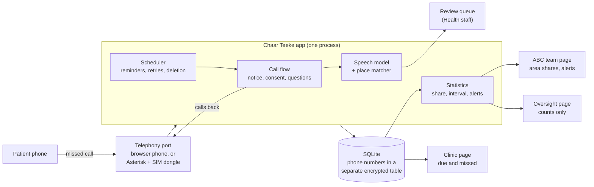

# Chaar Teeke

Chaar Teeke is a missed-call service for people bitten by dogs in Jammu. The patient gives one missed call at the anti-rabies clinic. A recorded voice then calls back in Dogri, Hindi or Urdu. It reminds the patient before each remaining rabies vaccine dose. On the first call it also asks four optional questions: where the bite happened, what kind of place, whether the dog had the right-ear V-notch that marks a dog Jammu Municipal Corporation (JMC) has sterilised, and whether the dog looked sick. The clinic sees who is due and who missed a dose. Jammu Smart City Limited's (JSCL) sterilisation team sees, by area, how many biting street dogs had the notch, with an interval that shows how sure the number is. It also gets same-day alerts about dogs that showed signs of rabies.

**Status: a prototype. It has not run with a real patient.** See [what is and is not verified](#honest-status).

## The problem in Jammu

- **76,824 dog bites in Jammu district over two years** (January 2024 to December 2025). This is from the Health Minister's reply in the Assembly, reported on 7 February 2026. The same reply gave no sterilisation data for the past two years in Jammu. [Hindustan Times](https://www.hindustantimes.com/cities/chandigarh-news/jk-reported-2l-dog-bite-cases-in-last-2-yrs-sakina-itoo-in-assembly-101770401242793.html)
- **JMC says about 39,000 of an estimated 50,000 street dogs in Jammu city are sterilised and vaccinated.** Each is released with a "Right Ear-notch". This is JMC's press release of 13 November 2024. [JMC](https://jmc.jk.gov.in/newsdetail.aspx?id=599) On 24 August 2026 the Chief Minister cited "around 80 per cent". [Kashmir Life](https://kashmirlife.net/cm-omar-calls-for-mission-mode-action-to-tackle-srinagars-stray-dog-menace-448938/)
- **We found no ward-level bite data published or shared with JMC** (searched 18 and 19 October 2026). JMC's own sterilisation page gives only yearly bite totals, from 5,184 in 2021-22 to 2,057 in 2022-23, "as per the information collected from the Health & Medical Education Department". [JMC](https://jmc.jk.gov.in/abcprogramme.html) So nobody can say where coverage is thin.
- **JSCL is getting a 55-person expert sterilisation team**, a pool shared across towns (a Housing and Urban Development order of 19 September 2026, reported on 1 and 2 October 2026). [Greater Kashmir](https://www.greaterkashmir.com/kashmir/jk-govt-sets-up-110-member-specialist-teams-to-tackle-stray-dog-menace-12615216) The Deputy Commissioner reviewed the anti-rabies and sterilisation work on 18 October 2026. [Kashmir Horizon](https://thekashmirhorizon.com/2026/10/18/dc-jammu-directs-for-expediting-anti-rabies-vaccination-sterilisation-campaigns-across-urban-rural-areas/) The team needs to know where to go first.

Why reminders: at one rural primary health centre in Puducherry, manual reminder calls the day before each dose raised completion of the 4-dose course from 60.2% to 70.4% (695 patients, 2022 to 2024, before-and-after, no control group). [Outlook](https://www.outlookindia.com/healthcare-spotlight/simple-phone-calls-improve-completion-of-life-saving-rabies-vaccination-finds-jipmer-study) Those were calls by staff. We do not claim an automated voice does as well. The pilot measures it.

## How it works

1. **Enrol.** The patient gives a missed call to the Chaar Teeke number, or clinic staff give it from the patient's phone. Staff link the call to the patient's register entry and choose the vaccine schedule. The software never chooses it.
2. **First call.** The system calls the patient back 8 seconds after staff link the missed call (a setting in `data/policy.json`; in the demo the browser phone is linked at once). It plays a short notice (what is kept, for how long, how to stop by pressing 9, and key 0 for the full notice) and asks for consent to reminders. If the clinic has marked the patient as an adult or as having a consenting guardian, it then asks the four questions. The patient can decline the whole set with one key and still get every reminder.
3. **Place.** The patient says the mohalla or nearest landmark. A speech model writes it down. A matcher compares it with 784 Jammu place names. If it is sure, it sets the ward. If not, a reviewer at Health picks the ward by listening to the clip. The clip is then deleted.
4. **Reminders.** At 18:30 the evening before each remaining dose the system calls with the clinic name, the dose number and the date. At 09:30 the morning after a dose the clinic has not marked, it asks "did you take it?".
5. **Clinic.** The clinic page lists today's due and missed patients. Staff mark doses.
6. **ABC team.** The team sees the notched share of street-dog bites by area, with its interval, how many answers it rests on and how many patients could not see the ear. A sick-dog answer makes an alert with ward, day and place type only. The team never sees a phone number.
7. **Deletion.** The phone number leaves the reminder system 7 days after the last scheduled dose, or at once if the patient withdraws.



More in [docs/ARCHITECTURE.md](docs/ARCHITECTURE.md).

## What a visitor can try in under 4 minutes

Open the page, scan the code with your own phone, give a missed call, answer the call in the browser, and watch your answers arrive on the laptop. Then jump the demo clock to the evening before your next dose and take the reminder call. Step by step: [docs/DEMO.md](docs/DEMO.md). Everything on the demo screens is synthetic and labelled DEMO DATA. The browser phone is labelled SIMULATOR.

## Run it locally

You need uv and Python 3.12. No Docker, no paid service, no internet after install.

```bash
uv sync
uv run chaar-teeke seed-demo           # synthetic DEMO data; prints the staff logins once
CT_ASR=off uv run chaar-teeke serve    # then open http://127.0.0.1:8080/
```

`CT_ASR=off` starts the app without the speech model, on purpose. Add the model later (below).

Open <http://127.0.0.1:8080/>. Click "Open the phone here" to use the browser phone. Visitors need no login. The staff logins are also written to `var/demo_logins.txt` (owner-readable only).

Check everything before a demo with `CT_ASR=off scripts/smoke.sh` (leave `CT_ASR=off` out once the model is installed). Run the full set of checks with `scripts/gate.sh`.

**Speech model (optional).** With `CT_ASR=off`, every place a patient says goes to the review queue with the note "No transcript: speech model off". Without that setting the app expects the model: if its folder is missing, the admin system tab shows a fault, the review queue says "No transcript. Listen and choose.", and `scripts/smoke.sh` fails. Nothing stands in for a missing model. To turn it on:

1. Get the AI4Bharat IndicConformer 600M multilingual model as ONNX files, [from Hugging Face](https://huggingface.co/ai4bharat/indic-conformer-600m-multilingual) (a click-through agreement applies). The folder needs `assets/preprocessor.ts`, `assets/encoder.onnx`, `assets/ctc_decoder.onnx`, `assets/vocab.json` and `assets/language_masks.json`.
2. `uv sync --extra asr`
3. `CT_ASR_MODEL_DIR=/path/to/that/folder uv run chaar-teeke serve` (without `CT_ASR=off`)

Load time and memory on an 8 GB Apple M1 laptop: [docs/EVALS.md](docs/EVALS.md#speech-model-load-time-and-memory). Settings are listed in [`.env.example`](.env.example).

## Honest status

What we have checked:

- The call flow, scheduler, deletion jobs, roles, small-number hiding and statistics are covered by offline tests (`scripts/gate.sh`).
- The telephony adapter passes its tests against a fake phone exchange and against a real Asterisk 22.11 on a Mac with simulated channels, with no phone network involved.
- The speech model, run inside the app's own code on 19 October 2026, on 12 machine-voice Hindi clips of place phrases: it placed 6 of the 6 clearly heard place names in the right ward, sent the 2 garbled ones to review, and placed none of the 4 phrases that are not places. Details and limits are in [docs/EVALS.md](docs/EVALS.md).

What is not verified:

- **No real phone line has been used.** The SIM-dongle path is written and tested only against Asterisk's test channels. Whether the dongle registers for voice calls on an Indian SIM, detects key presses and gives usable audio is unknown until the hardware arrives. [docs/TELEPHONY.md](docs/TELEPHONY.md) has the day-1 checklist.
- **All prompt audio is machine voice.** No native speaker has read the Hindi, Dogri or Urdu texts. The Dogri and Urdu texts are machine drafts. The browser phone says "Machine voice draft".
- **No real caller has been recorded.** The speech and matching numbers come from machine voices and from 44 recordings of ordinary Dogri speech (not place names). A frightened person on a poor line will do worse.
- **No real bite data exists in the demo.** The map is synthetic. It holds about 760 answers over 12 weeks, more than a 12-week pilot at one clinic could (at most 175), so the demo's areas show shares and "look here" flags that a pilot would not yet.
- The notched share among biting dogs is a sign of where to look first, not a count of dogs and not a measure of coverage. If sterilised dogs bite less often than others, the expected share is lower than the coverage. The team's own sight-counts are how to calibrate it.
- The bite figures in different Assembly replies do not reconcile with each other, and we use only the 76,824 figure, with its stated period.
- Nobody has reviewed the privacy design with a lawyer. The Digital Personal Data Protection Rules 2025 apply from 13 May 2027, after the planned pilot.
- Only one clinic is confirmed to give anti-rabies injections: GMC Jammu's anti-rabies clinic, from the National Rabies Control Programme list updated 26 March 2026. The other candidates are marked unverified.

## Privacy in five bullets

- The patient hears a short notice (about 24 seconds; key 0 plays the full notice) and agrees before any data is kept. Pressing 9 on a call (and 9 again to confirm) stops everything. So does a further missed call after the "you are already signed up" message.
- Phone numbers sit in their own encrypted table, with every reveal logged. They leave the reminder system 7 days after the last dose.
- The voice clip of a place is deleted once a ward is set, and in any case after 7 days.
- JSCL sees only counts by area. Counts under 5 show as "<5". A percentage appears only from 25 answers.
- No name, date of birth, address or Aadhaar number is collected. The clinic only marks the patient as an adult or under 18 with a guardian's consent. Provider and security logs may be kept longer as the law requires. See [docs/PRIVACY.md](docs/PRIVACY.md).

## The pilot ask

A 12-week pilot at the anti-rabies clinic of Government Medical College (GMC) Jammu, and one more clinic if the Health department confirms one. It needs an order from the Deputy Commissioner that brings together JSCL and GMC's Community Medicine department, with Health as the data fiduciary. Telephony for real patients must go through a registered provider. At the planned 700 new patients in 8 weeks and a 50% enrolment target, at most 175 patients answer the questions. That is enough to compare the city-wide notched share with the 78 to 80% claim, roughly (about 6 to 7 points either side at best), and to test whether reminders raise completion. It is not enough to flag individual areas. Details, metrics and the decisions needed: [docs/PILOT.md](docs/PILOT.md).

## Documents

[Architecture](docs/ARCHITECTURE.md) · [Module contract](MODULES.md) · [Design](docs/DESIGN.md) · [Privacy](docs/PRIVACY.md) · [Pilot](docs/PILOT.md) · [Telephony](docs/TELEPHONY.md) · [Deploy the pilot box](docs/DEPLOY.md) · [Demo script](docs/DEMO.md) · [Evaluations](docs/EVALS.md) · [Data and model licences](docs/DATA-LICENCES.md)

## Team

Akash Kumar and Asish Kumar.

## Licence

The code and the documentation we wrote are MIT ([LICENSE](LICENSE)). Third-party data, fonts, models and voices keep their own terms: see [docs/DATA-LICENCES.md](docs/DATA-LICENCES.md) and [NOTICE](NOTICE). The machine voices are for prototype use only (CC BY-NC 4.0).

Contains data (c) OpenStreetMap contributors, ODbL 1.0. <https://www.openstreetmap.org/copyright>
