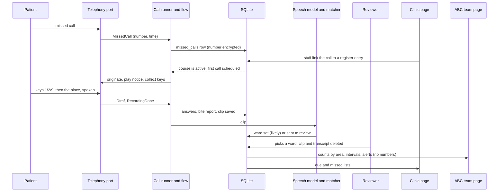

# Architecture

Chaar Teeke is one Python process (FastAPI) with one SQLite database. The pages are plain HTML, CSS and JavaScript with no build step. The signatures, owners and HTTP shapes are in [MODULES.md](../MODULES.md). This file explains how the parts fit.

## Components

| Part | Where | Job |
|---|---|---|
| Web app and API | `chaarteeke/api/` | Pages, JSON routes, sign-in, live updates (server-sent events), the browser-phone WebSocket |
| Call flow | `chaarteeke/ivr/flow.py` | A pure state machine: keys and silence in, prompts and saves out. It does no input or output |
| Call runner | `chaarteeke/ivr/runner.py` | Drives the flow over the telephony port, saves answers, hands clips to the place step |
| Prompts | `chaarteeke/ivr/prompts.py`, `data/prompts/` | Texts in three languages and the audio for each. A prompt with no audio in a language is a start-up error for that language |
| Telephony port | `chaarteeke/telephony/` | One interface, two transports: the browser phone and Asterisk over ARI |
| Scheduler | `chaarteeke/scheduler.py` | Plans reminder calls, places them in the calling window, retries, runs deletion jobs |
| Enrolment and doses | `chaarteeke/enrol.py`, `doses.py`, `regimens.py` | Courses, missed-call linking, dose states |
| Speech and places | `chaarteeke/speech/`, `chaarteeke/places/` | Speech to text, place-name matching, the review queue |
| Statistics | `chaarteeke/stats/`, `chaarteeke/alerts.py` | Notched share with intervals, clusters, look-here flags, hiding small numbers, sick-dog alerts |
| Privacy jobs | `chaarteeke/privacy.py`, `crypto.py`, `audit.py` | Phone vault, deletion, the audit log |
| Demo | `chaarteeke/demo/` | Seeded synthetic history, the demo clock |
| Settings | `data/policy.json` | Every threshold, versioned and hashed. A test pins each version |

## Data flow

Three rules hold across this flow. Only the clinic marks a dose as given, except that a patient's "I took it" on the morning call is recorded as given by the patient. A dog answer never changes the schedule. Every state change writes an audit row in its own database transaction and publishes one live event after it commits. Events carry ids and small facts, never a phone number.

## The telephony port

The app depends on one interface, `TelephonyPort` (`chaarteeke/telephony/model.py`).

- **Events in:** missed call, call answered, key pressed, playback finished, recording done, hang-up.
- **Commands out:** place a call, play prompts, record, hang up, fetch a recording, delete a recording.

Two transports sit behind it. They are chosen by `CT_TELEPHONY` and never switch silently.

| Transport | `CT_TELEPHONY` | What it is |
|---|---|---|
| Browser phone | `sim` | A web page that acts as a phone over a WebSocket. Numbers look like `sim:<session>`. The page says SIMULATOR. Used for the demo and for tests |
| Asterisk over ARI | `ari` | Asterisk's REST and WebSocket interface. The endpoint is a setting: a SIM-dongle channel for the demo, or a registered provider's SIP trunk for a pilot. Same code, different endpoint string |

`ari,sim` runs both: numbers starting `sim:` go to the browser phone and others to Asterisk. If a transport fails, the failure shows on the admin system tab and as a one-line banner where calls are shown. Nothing reroutes to the other one. Setup: [TELEPHONY.md](TELEPHONY.md).

## Scheduler rules

All values are in `data/policy.json` (version 2026.10.3).

- **One writer.** The scheduler holds a database lock with a heartbeat (stale after 30 s). A second process waits. A restart cannot call a patient twice.
- **Idempotent jobs.** Each call has a unique key built from kind, course, dose and local date (the first call uses `first:<course>`). Planning the same call twice is a no-op.
- **When.** Evening reminder at 18:30 the day before each dose after dose 1. Morning-after call at 09:30 the day after a due dose that is not marked. Calls go out only between 09:00 and 20:00 local time. The window does not apply to the browser phone.
- **Retries.** Ring for up to 30 s. Up to 3 attempts per call, with gaps of 20 minutes and 2 hours. Each attempt shows on the clinic list.
- **One at a time on a real line.** A dongle has one voice channel, so real calls go one by one. Browser phones run in parallel.
- **Demo data is never called.** Courses made by the seed script are never planned, dialled or retried.
- **Deletion.** The purge job runs every 60 s. It removes phone numbers 7 days after the last scheduled dose, voice clips once decided or after 7 days, and unlinked missed calls after 48 hours.
- **One clock.** All code reads time from `chaarteeke.clock`. The demo clock moves it forward. Nothing calls the system time directly, and a test enforces this.

## Security

- **Roles, enforced on the server.** `clinic` (own clinic only), `abc` (the sterilisation team), `vet` (can claim and act on alerts), `oversight` (summary and weekly counts), `reviewer` (place review, the register export, and the oversight summary), `admin` (sets up clinics, people and prompts; does not hear recordings or read the register export). A visitor in demo mode can read the pages of the role they chose. Every write returns 403, except the two demo controls: opening a browser phone and moving the demo clock. A test runs every route against every role.
- **Sign-in.** Passwords are hashed with scrypt. Five failed sign-ins in 10 minutes make the app refuse further tries for that username and that address until the oldest failure is more than 10 minutes old. In pilot mode the app refuses to start without `CT_SECRET_KEY` and `CT_PHONE_KEY`.
- **Sessions.** The cookie `ct_session` is HttpOnly and SameSite=Lax, and Secure on https. The server keeps only a hash of the token. A session lasts 12 hours.
- **CSRF.** Every write needs the header `X-CT-CSRF` with the token issued at sign-in.
- **Content security policy.** `default-src 'self'; script-src 'self'; style-src 'self'; font-src 'self'; connect-src 'self'; frame-ancestors 'none'`, plus `img-src` and `media-src` for `data:` and `blob:` (the map and the recorded clip). No outside host is named, and a test fails if one is added. The map library is vendored in `web/vendor/`. The browser phone's WebSocket goes to this server only: when `CT_PUBLIC_URL` is set, `connect-src` also names its exact `wss://` (or `ws://`) origin, and nothing else. No inline script or style. On an https address the server also sends `Strict-Transport-Security`.
- **Untrusted text.** Transcripts, place names and aliases enter the page with `textContent` only.
- **Phone numbers.** Stored encrypted (Fernet) in `contacts` and `missed_calls`, with the last four digits in the clear. Revealing a number is a separate, audited action. Numbers are never in events, exports or the app's own logs. Asterisk's logs and the provider's records are separate: see [TELEPHONY.md](TELEPHONY.md).
- **Audit.** Every state change and every reveal writes a row to the `audit` table. It is append-only in the database, not only in the code: triggers refuse any UPDATE or DELETE, and the demo reset leaves it alone. The administrator reads it in the Audit tab (`GET /api/admin/audit`, paged, filtered by action and object, phone-number actions first).

## Module map

Ownership and signatures for every module are in [MODULES.md](../MODULES.md). The design system is in [DESIGN.md](DESIGN.md). Tests are under `tests/`, grouped the same way as the code: `core`, `ivr`, `places`, `stats`, `telephony`, `api`.
