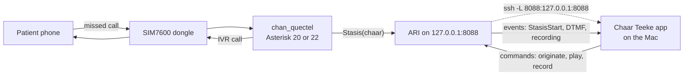

# Telephony

How Chaar Teeke would reach a real phone. **None of this has run on a real phone line yet.** The browser phone ([DEMO.md](DEMO.md)) is the only transport that has been used end to end. The adapter has been tested against a fake phone exchange, against a real Asterisk 22.11 on a Mac using simulated channels, and end to end on a SIP softphone with no cellular network (see [Tested on a SIP softphone](#tested-on-a-sip-softphone-no-cellular-network)). The dongle, the driver, the cellular network and real handset audio have not been tested. Labels below: **tested** means we ran it; **sourced** means we read it in the maintainer's pages; **hardware** means it can only be known once the dongle is in hand.

## The plan in one page

1. **Phone path for the demo:** one SIMCom SIM7600G-H USB dongle (the Waveshare 4G dongle) with one Indian SIM, plugged into a Linux machine that runs Asterisk with the `chan_quectel` driver.
2. **The app talks to Asterisk only through ARI**, Asterisk's REST and WebSocket interface. The dialplan is about 40 lines and never changes.
3. **The Mac cannot drive the dongle.** `chan_quectel` needs Linux serial ports and audio headers to build. Use a Raspberry Pi 4 or 5 on a powered USB hub, a spare x86 laptop, or a Linux virtual machine with USB passthrough (UTM with the QEMU backend; not tried). Lima cannot pass USB through.
4. **The app can stay on the Mac.** It reaches the Linux machine's ARI over an SSH tunnel. ARI listens on loopback only and is never exposed.
5. **For a pilot, only the endpoint changes.** The same adapter dials a registered provider's SIP trunk instead of the dongle.

## What each call looks like

- **Missed call.** The patient rings the dongle's number. The dialplan hands the call to the app and never calls `Answer()`. The adapter reads the caller number, emits a missed-call event and hangs up the unanswered call, so it should cost the patient nothing (day-1 step 5 checks this). A withheld number arrives as no number. The app cannot call it back and says so on screen.
- **Outgoing call.** The adapter places a call to the endpoint `Quectel/sim7600-0/{number}` and opens the event socket with `subscribeAll=true`, so a busy, rejected or unanswered call still produces an event. On pick-up the app plays prompts, reads key presses and records speech.

## The adapter (what the app uses)

`chaarteeke/telephony/model.py` defines the port. `ari.py` implements it for Asterisk. `fake_ari.py` imitates Asterisk for tests. `sim.py` implements the browser phone. `mux.py` routes by number. `numbers.py` turns caller-ID formats into `+91...` numbers.

- **Events:** `MissedCall`, `CallAnswered`, `Dtmf`, `PlaybackFinished`, `RecordingDone`, `Hangup`.
- **Commands:** `originate`, `play`, `record`, `hangup`, `fetch_recording`, `delete_recording`.
- **Errors are never swallowed.** A refused command and a dropped event socket both raise. There is no automatic reconnect and no other route. The app shows the fault where calls are shown.
- **A silent line still finishes a recording.** Asterisk reports a recording as done with zero length. The app checks the duration and the voiced seconds it measures in the fetched audio (see [With the speech model on](#with-the-speech-model-on-20-october-2026)), not only the "done" flag and not Asterisk's talking time.
- **A recording that never started is not a recording.** On a real Asterisk, a record request with `beep=true` and no `beep` sound installed was answered with success and then ended at once as "done" with no length and no file. The adapter now reports a "done" recording with no duration as failed ("Asterisk finished the recording without recording anything (is its 'beep' sound installed?)"). `telephony/asterisk/sounds/beep.wav` is the sound; install it as `beep.wav` in Asterisk's sounds folder.

Settings: `CT_TELEPHONY` (`sim`, `ari` or `ari,sim`), `CT_ARI_URL`, `CT_ARI_USER`, `CT_ARI_PASSWORD`, `CT_ARI_ENDPOINT`. See [`.env.example`](../.env.example).

## Tested on a SIP softphone (no cellular network)

Run on 19 October 2026 on the build Mac (8 GB, Apple silicon), all on one machine: Asterisk 22.11.0 (a private build with ARI and PJSIP, using the files in `telephony/asterisk/etc/asterisk/`), baresip 4.12.0 as the patient's phone, and the app in demo mode with `CT_TELEPHONY=ari` and `CT_ASR=off`. The app's own `AriAdapter` and `CallRunner` ran unchanged. Nothing was stubbed in them, no outside service was called and no real phone was rung.

Run it: `scripts/sip_e2e.sh` (needs `uv`, `ffmpeg`, `baresip` and a private Asterisk 22 at `$ASTERISK_PREFIX`), or `CT_TEST_SIP=1 uv run pytest tests/telephony/test_sip_e2e.py -q`. Without `CT_TEST_SIP=1` the run is skipped, not replaced. It starts Asterisk, baresip and the app and stops each by its own process id. The speech model is off in this run. To run it with the model on, see [With the speech model on](#with-the-speech-model-on-20-october-2026).

What happened, in order:

1. The softphone registered to Asterisk and dialled the missed-call extension. Asterisk handed the call to the app and never answered it; the softphone's call closed with `603 Decline`. The missed call was listed in the clinic's Today as unlinked, showing the last four digits only.
2. The clinic user (signed in over the HTTP API) linked the missed call to an enrolled course.
3. The app's first call went out over ARI and rang the softphone, which answered by itself.
4. The app played its prompts over RTP. A driver pressed the keys a patient would, while each question played, as RFC 4733 events: consent to reminders, consent to the questions, place type, street dog, right-ear notch, no signs. The driver knew what was playing from a second, read-only listener on Asterisk's event socket, which sends no command.
5. At the place question the driver played a recorded WAV (the demo clip `data/demo/clips/1.wav`, 1.61 s) into the call after the beep. Asterisk recorded it and the app fetched it, saved the six answers and the bite report, handed the clip to review (`needs_review`, because the speech model was off) and deleted Asterisk's copy. A reviewer login fetched the clip and it held speech.
6. The call row ended `completed` with answered time, end time and hang-up cause 16 set. Asterisk, the softphone and the app were stopped, and the patient number (a test number in the reserved `+91 99999 0xxxx` range) was in no Asterisk or app log.

What was measured (three passing runs on this machine, 25 of 25 checks each, SIP and RTP between processes on this one machine, one call each, so these are three samples and not a distribution; the report file of each is on disk):

| Measure | 21:55 | 23:45 | 23:57 |
|---|---|---|---|
| Missed call (dial) to the softphone ringing | 13.47 s | 9.24 s | 9.23 s |
| of which: link to ring | 12.88 s | 8.93 s | 8.92 s |
| Missed call dial to listed for the clinic | 0.59 s | 0.31 s | 0.32 s |
| First call, answer to hang-up | 83.50 s | 83.56 s | 83.56 s |
| Keys sent / received by Asterisk / lost | 6 / 6 / 0 | 6 / 6 / 0 | 6 / 6 / 0 |
| Key press command to Asterisk's key event | 187 to 199 ms | 187 to 201 ms | 187 to 200 ms |
| Place recording: length, talking time | 2 s, 2 s | 2 s, 2 s | 2 s, 2 s |
| Clip fetched by the reviewer | 1.76 s | 1.78 s | 1.76 s |

The first run was the slowest to ring and the cause of the extra 4 s was not looked for. Another passing run (through pytest, 98 s) was made on the same evening; its report file was not kept, so its figures are not in the table.

The link-to-ring time in the last two runs is the policy delay `calls.first_call_delay_s` (8 s) plus about 0.9 s that was not broken down. The call length is the prompts playing plus the pauses before each key; it was not split further. Asterisk reported each key as 180 ms long, and Asterisk reports a key when it ends (our reading, not tested separately), so most of the 187 to 201 ms between our command and the key event is the key itself and not network or processing time.

Two things in the shipped files were wrong and are fixed: a `;` inside `NoOp(...)` in `extensions.conf` cut the line and warned at every missed call, and `modules.conf` did not noload the IAX2, UniStim and DUNDi modules, which open ports on every network address (an earlier listing of a running Asterisk showed them; a later listing with the fix showed none of the three ports open), or Asterisk 22's combined call-record writer. Both have tests.

How the rig differs from the shipped files, so the result is not read as more than it is:

- baresip ignores loopback addresses, so for the run the generated copy of `pjsip.conf` binds Asterisk's SIP to this machine's own address, and an ACL lets only that address in. The shipped file still binds `127.0.0.1` and is not changed. The softphone's password is made fresh for each run.
- The test-only `softphone` endpoint is in the shipped `pjsip.conf`, marked test only, with every bind on loopback and a development password. Remove it before a pilot (see [DEPLOY.md](DEPLOY.md)).
- When the clock is outside the calling window (09:00 to 20:00), the app is told to count local time in a zone where it is early afternoon (`CT_LOCAL_TZ`). The window and the clock are as shipped. Both runs above used this, because they ran at night.
- In the three runs above the speech model was off, so they show the clip reaching review, not a place being understood. The runs with the model on are in the next section.
- The prompt audio was converted by `telephony/scripts/convert_prompts.sh` (216 files, Hindi prompts).

What this does not show, and stays **not tested** until the dongle or a provider trunk is in hand: the SIM7600 dongle and `chan_quectel` (the driver is not built here), registering on a cellular network for voice, Jio and Airtel behaviour, whether a rejected missed call is charged, the caller-ID delay of a real network, key presses detected by the dongle (here they are RFC 4733 events from a softphone), audio quality and gain on a handset or over the serial audio port, answer detection against voicemail, call-back timing after a rejected call, one voice channel limits, the 12-hour soak, power, carrier throttling, and any licensed provider trunk. Every item of the day-1 checklist below except the Asterisk side of step 11 is still to do on hardware.

### With the speech model on (20 October 2026)

Same rig and machine as above, but the app ran with `CT_ASR=indicconformer`. This is opt in and the default run is unchanged: `CT_ASR_MODEL_DIR=<model folder> scripts/sip_e2e.sh --asr --expect-ward 6 --clip data/demo/clips/1.wav`, or `CT_TEST_SIP_ASR=1 CT_ASR_MODEL_DIR=<model folder> uv run pytest tests/telephony/test_sip_e2e.py -q -k speech_model_places`. There is no default model folder. The rig waits until the app says the model is loaded, then the softphone gives the missed call and the first call goes out as before. The place question is answered by baresip playing a demo clip, which Asterisk receives as 8 kHz RTP (PCMU), records, and hands to the app. The app fetches it, reads it with its own `Transcriber`, matches it with keyword spotting, and either sets the ward or queues the report for review. `scripts/sip_e2e_heard.py` then loads the model once more, after everything has stopped, and reads the same recordings to show the words, because the app deletes the clip, the words and the candidates the moment it places a report by itself (this is on purpose, for privacy).

**What this is.** 18 calls on one 8 GB Apple M1, one call per run, seven clips of one machine voice (Meta MMS-TTS Hindi, the demo clips, made for the demo), Hindi hint only. No real caller, no real handset, no cellular line. These are samples, not rates.

| Clip | What the voice said | Right ward | Calls | What the model heard (from the file the app saved) | What the app did |
|---|---|---|--:|---|---|
| 1 | mera ghar Gujjar Nagar mein hai | 6 | 4 | मेरा घर गुज्जर नगर में है | placed in ward 6 by itself, 4 of 4 |
| 7 | Upper Muthi ke paas | 66 | 2 | अपर मुठी के पास | placed in ward 66 by itself, 2 of 2 |
| 8 | नानक नगर पश्चिम में | 42 | 2 | नानक नगर पश्चिम में | placed in ward 42 by itself, 2 of 2 |
| 11 | mera ghar Channi Biza mein hai | 53 | 2 | मेरा घर छन्नी बीज़ा त्रिकोट नगर में है | to review, 2 of 2: "possible", wards 52, 53 and 50 offered (52 and 53 both scored 100) |
| 3 | bus adde ke paas (not a place) | none | 1 | बस अड्डे के पास | to review with no candidate (right) |
| 2 | अपर मुट्ठी में | 66 | 6 | अप पर मुठ्ठी में | placed in ward 66 in 2 of 6 calls; in the other 4 the app lost the place (below) |
| 5 | Gole chowk par | 32 | 1 | और चौक हुआ (from Asterisk's copy) | lost the same way (below); these words match no ward, so it would have gone to review with no candidate |

In the 18 calls, 10 were placed by themselves, all in the right ward; none was placed in a wrong ward. 3 went to review (clip 3 correctly, and clip 11 twice, where ward 53 was offered but not set by itself). 5 lost the place. The model's own confidence figure (mean probability of the letters it kept) was 1.0 to four decimals on every read, including a one-letter read of a silent file, so it says nothing here; the matcher's label is what decides. The rig kept Asterisk's own copy of every recording attempt in the last 14 calls; in all 14 the file the app saved was byte for byte one of them (the first recording in 10 calls, the second in the 4 lost ones). The listening pass read the app's file in all 18 calls: its decision matched the app's in 18 of 18, the ward matched in the 10 placed calls, and in the 8 calls that ended in review the words it found were the words the app had stored (8 of 8).

**Words over the phone line against the studio run.** The 19 October in-app run ([EVALS.md](EVALS.md#speech-model-on-the-demo-clips-inside-the-app-19-october-2026)) read these WAV files directly. Over SIP and RTP the words were the same for clips 1, 2, 7 and 8, and different for three: clip 11 ("त्रिकोटा" there, "त्रिकोट" here, which moved the result from placed in ward 53 to review), clip 3 ("बस अ्दे के पास" there, "बस अड्डे के पास" here, still no place) and clip 5 ("औरो चौक हुआ" there, "और चौक हुआ" here, still no ward). We did not isolate which step of the path (PCMU, Asterisk, the app's resampling) causes a difference.

**Timings** (this machine, SIP and RTP on its own address):

| Measure | Value |
|---|---|
| App process start to "speech model loaded" | 7.1 to 8.3 s in 17 starts (the first run, before the fix below, said 1.2 s because the weights were not loaded yet) |
| Asterisk "recording finished" to the ward set or the report queued (fetch, save, read, match, write) | 1.86 to 2.31 s in 12 calls where the first recording was used; 11.26 s in the one call (before the fix below) where the first clip also loaded the weights |
| Missed call to the softphone ringing | 11.6 to 12.9 s with the model loaded (8.8 s in the one call where the weights were not loaded; 9.2 to 13.5 s with the model off above). The 8 s policy delay is included. The extra seconds with the model loaded were not looked into. |
| Key press command to Asterisk's key event | 180 to 202 ms, as before |
| First call, answer to hang-up | 82.9 to 85.0 s in the 13 calls with one place recording (93.2 to 93.4 s in the 5 lost calls, which play the question twice) |

The reading time inside the app is part of the 2 s above. In the listening pass, the first clip read after a load took 1.6 to 1.9 s and later clips 0.0 to 0.2 s; every call here started a fresh app, so each call paid the first-read cost. The listening pass peaked at 2.59 GB (`/usr/bin/time -l`, one run) and loaded in 6.3 to 6.6 s in four runs. Only one speech-model copy was in memory at any time: the app's copy had stopped before the listening pass loaded its own.

**Two defects this found (both fixed).**

1. **Fixed: the app said the speech model was loaded before its weights were.** `/api/system/status` said "The speech model is loaded" once the folder and libraries were checked, but the 2.2 GB of weights were read on the first recording, so the first patient's place waited for them (11.26 s in the first call above). `chaarteeke/api/app.py` now reads the weights in the start-up thread before it says "ready" (as `preflight` already does). A recording that arrives meanwhile waits for the weights; a load that fails sets the status to failed and recordings are refused with the reason. Two tests pin this in `tests/api/test_app.py`.
2. **Fixed on 20 October 2026: Asterisk's talking time cannot tell a short spoken place from silence, and the flow asked again on "0".** What the first 18 calls showed, kept as found: Asterisk gives talking time in whole seconds (our reading; every value we saw was a whole number). The same 0.95 s clip, saved by Asterisk as a 1.14 s file with the same level every time (0.096 to 0.097), came back as talking 1 in 2 calls and talking 0 in 4 calls. `Flow._place` counted `talking_s > 0` as speech, so on 0 it played "ask again" (`FC_PLACE_AGAIN`) and recorded again. In that rig the patient does not repeat, so the second recording was 0.2 s of silence, which Asterisk reported as talking 1 s in all 5 lost calls. The app read that (the word "ह"), found no ward, and queued the report with two unrelated candidates while the real place, which Asterisk had recorded, was thrown away. It hit the two clips of 1 s or less (clip 2 in 4 of 6 calls, clip 5 in 1 of 1) and none of the 11 calls with clips of 1.15 s or longer.

   **The fix.** The app now decides for itself, from the recording it fetched, whether there was speech, the same way for the browser phone and for ARI: the runner fetches each recording that finished ok, cuts it into 20 ms frames, and counts a frame as voiced when its RMS (samples scaled to -1..1) is at least `calls.speech_frame_rms_min` (0.02); voiced seconds are voiced frames times 0.02 (`chaarteeke/ivr/voiced.py`). The flow keeps the place when the voiced seconds reach `calls.speech_min_voiced_s` (0.25). Both numbers are in `data/policy.json` (version 2026.10.9, new pin). Asterisk's talking time is still read and shown, as information only. The measured voiced seconds are stored on the place capture (`place_captures.voiced_s`, migration 0004) for review. A recording taken as silent still gets the one `FC_PLACE_AGAIN` retry; a recording that is not a readable 16-bit WAV ends the call with "The place recording could not be read" and nothing stands in for it. The two numbers were checked on the files before the SIP run: all 12 demo clips in `data/demo/clips` are voiced 0.46 s or more (shortest: clip 5, 0.46 s; clip 2, 0.60 s; clip 1, 1.22 s), and a silent file, a 44-byte file and 0.2 s of loud noise measure under 0.25 s in the unit tests (`tests/ivr/test_voiced.py`). The 0.25 s minimum is therefore tuned on twelve machine-voice clips and on synthetic noise, not on a real handset or a noisy line.

   **Re-run on the same rig, same day** (`scripts/sip_e2e.sh --asr`, model `indic-conformer-600m-multilingual` fp32, one call per run, 7 calls, one 8 GB Apple M1, machine voice; every check passed: 29 of 29 in the clip 2 and clip 1 runs, 28 of 28 in the clip 5 runs, which have no ward to check). Asterisk's file for the clip was the same as before (clip 2: 1.14 s, level 0.096; clip 5: 1.02 s, level 0.088), and the app's file was byte for byte Asterisk's in all 7.

   | Clip | Asterisk duration / talking | Voiced seconds the app measured | Calls | What the model heard (listening pass, app's own file) | What the app did |
   |---|---|--:|--:|---|---|
   | 2 "अपर मुट्ठी में" (0.95 s), expect ward 66 | 1 s / **0 s** in 3 of 3 | 0.60 | 3 | अप मुठ्ठी में, 3 of 3 | kept on the first recording in 3 of 3, placed in ward 66 by itself in 3 of 3, no second question |
   | 5 "Gole chowk par" (0.82 s), no ward expected | 1 s / **0 s** in 3 of 3 | 0.46 | 3 | और चौकवाआ, औरर चौकआ, और चौक हुआ | kept in 3 of 3, none placed; 3 to review: 2 with no candidate, 1 with wards 26 and 38 offered "possible" (not the place; none set) |
   | 1 "mera ghar Gujjar Nagar mein hai" (1.61 s), control, expect ward 6 | 2 s / 2 s | 1.22 | 1 | मेरा घर गुज्जर नगर में है | placed in ward 6 by itself |

   Before the fix, clip 2 lost the place in 4 of 6 calls and clip 5 in 1 of 1; now the first recording was kept in 7 of 7 calls, including the 6 where Asterisk said talking 0. The words the model read on clip 5 differ between the three calls (three spellings of the same recording), which is how the model reads a 1 s clip of one machine voice, not a change in the app; the combined matcher did not place it in any of them. Asterisk recorded one attempt in each call, so no call asked the place question twice. The time from Asterisk's "recording finished" to the ward set or the report queued was 1.82 to 2.80 s in the 7 calls (every call started a fresh app). The listening pass loaded the model once for all seven runs (6.8 s) with the app's processes stopped. This shows the short-clip defect gone for these two clips on this rig; it does not show a real voice, a quiet or noisy handset line, or a patient who speaks softly (a soft voice under 0.02 frame RMS would still count as silent).

**What this still does not show:** a real voice, a real handset or network audio, Dogri or Urdu, a patient who repeats the place when asked again, or more than one call at once. The model, the gazetteer and the thresholds are the ones that ship.

## Day-1 hardware checklist

Only verifiable once the dongle is bought. Do these in order. Each can end the plan or change it. `telephony/scripts/dongle_probe.py` runs the read-only part of step 1 and 2 (stop Asterisk first, since it owns the port).

1. **Linux sees the module.** `lsusb` shows `1e0e:9001` and five `ttyUSB` ports appear. If the host is a virtual machine, this is where passthrough works or does not.
2. **The SIM registers for voice.** Being registered for data is not enough. Place a call from the dongle to your own phone. Try an Airtel SIM first (2G fallback may exist), then a Jio SIM with the VoLTE switch on (`at+voltesetting=1`, from the Waveshare FAQ; result unknown). Jio has no 2G or 3G voice. This is the biggest risk to a live missed call on stage.
3. **Key presses (DTMF).** Call your phone and press 1, 5, 9, star and hash. Confirm ARI reports each one. This is make-or-break for a keypad service. If the module's own detector fails, switch to the in-band detection driver fork, or redesign the first call around spoken answers.
4. **Audio both ways.** Hear the prompt clearly. Record 10 seconds of Hindi and Dogri speech and listen back. Run the speech model on the recorded files, since phone-band audio is a different input from studio audio. Tune gain one value at a time (the maintainer suggests `AT+COUTGAIN=8`, `AT+CMICGAIN=3`, `AT+CECM=0` as a start; never set all gains to 0).
5. **Missed call.** Ring the dongle from a second phone and let it ring. Confirm the number arrives, the call ends unanswered, the caller is not charged and the end tone is sensible. Test a withheld number. Time first ring to event.
6. **Call-back timing.** How soon after rejecting the missed call can the dongle call the same number without "busy"?
7. **Reliability.** 20 outgoing calls to two phones. Count failures, one-way audio and late answer detection. Check that "answered" means a person, not voicemail.
8. **Soak.** Leave it 12 hours. Does the module re-register and Asterisk stay up?
9. **Power.** Run an hour on the intended powered hub.
10. **Carrier behaviour.** Check the SIM has not been throttled. TRAI's February 2025 note tells operators to look for unusual call volumes, short calls and low incoming-to-outgoing ratios. A test loop looks exactly like that. Keep loops small.
11. **No call records, short logs.** `asterisk -rx 'module show like cdr_'` and `asterisk -rx 'module show like cel_'` list no running backend, and `asterisk -rx 'cdr show status'` and `'cel show status'` say logging is disabled (modules.conf noloads the backends; the CDR engine, `app_cdr`, `func_cdr` and `app_forkcdr` are core modules that always load, as seen on Ubuntu 24.04 with Asterisk 20; cdr.conf and cel.conf say `enable=no`). After the test calls from steps 2 to 7, `/var/log/asterisk/messages.log` holds no phone number, `/var/log/asterisk/` has no `cdr-csv` or `Master.csv`, and `/etc/logrotate.d/asterisk` is installed from `telephony/asterisk/etc/logrotate.d/asterisk` (7 days).

## Known limits of the dongle

- **One voice channel.** A missed call that arrives during an IVR call is lost. Fine for a demo with one visitor at a time. Not a pilot design.
- **Driver age.** The `chan_quectel` fork that documents this dongle (RoEdAl) was archived on 13 September 2024. Pin its last commit and build against Asterisk 20 LTS first. Try 22 only if it compiles.
- **Audio over a serial port** is lower quality than a USB sound card and more fragile.
- **Patient numbers can reach Asterisk logs and the recording spool.** The logger config drops verbose lines, no call records are kept (day-1 step 11) and logrotate deletes logs after 7 days. The app deletes each recording once fetched.

## Indian calling rules

Our reading of the regulator's text, for planning. Not legal advice. The pilot needs a ruling from the telephony provider and from Health's or JSCL's legal desk.

- **Demo only: a consumer SIM in a dongle.** A few calls to the team's own phones and to a consenting outside person are fine. Tell people the number is a demo line. Do not use it for real patients. Automated calls from an ordinary 10-digit number are what the TRAI's 2025 amendment to the telecom commercial communications rules targets.
- **Pilot: a registered sender.** Automated, pre-recorded calls to real patients need a registered sender, a number in the 1600 series (set aside by TRAI in February 2025 for service and transactional calls) or the government-call route, and advance notice to the operator that auto-dialling is used. The sender should be Health, JSCL or the clinic, not the student team.
- **Which category?** A first call made within 30 minutes of the patient's own missed call fits a transactional call. Later reminders fit a service call, or a government call if Health or JSCL directs them. The category decides whether a patient who has blocked commercial calls still gets the reminder. The provider should confirm.
- **Consent lasts 7 days on the "ongoing transaction" route.** Courses run up to 28 days. Either run the reminders as government calls, or ask the patient again around day 7. The policy file holds a value `reconsent_after_days: 7` for this, but no code reads it yet: re-asking for consent is not built.
- **Calling hours.** We call between 09:00 and 20:00 local time by choice. The 9 am to 9 pm limit in the rules applies to promotional calls.
- **Penalties.** Per the TRAI press release, a first violation bars the sender's outgoing services for 15 days. Further violations can disconnect all resources, including SIP trunks, for a year.
- **A pending change.** A draft third amendment of 13 March 2026 would define automated calls and add a charge. We did not find whether it is final.
- **Provider status.** No direction we read covers health or government use of the 1600 series yet. Whether it applies to Health must be asked of the provider.

## Files in `telephony/`

| File | What it is | Status |
|---|---|---|
| `asterisk/etc/asterisk/http.conf` | ARI transport on loopback `127.0.0.1:8088` | Loaded by Asterisk 22.11 on a Mac; ARI answered |
| `asterisk/etc/asterisk/ari.conf` | The `chaar` ARI user. Replace the development password | Loaded on a Mac |
| `asterisk/etc/asterisk/pjsip.conf` | A test-only softphone endpoint for SIP-only tests (loopback only, development password), and a commented provider-trunk template for the pilot | The softphone: tested end to end with baresip. The trunk template is untested |
| `asterisk/etc/asterisk/extensions.conf` | Dialplan: every incoming route ends in `Stasis(chaar,incoming)`. No `Answer()` anywhere. Logs an error if the app is not running | Tested with local channels and with the softphone's missed call (`from-softphone`). The dongle route `quectel-incoming` is untested |
| `asterisk/etc/asterisk/quectel.conf` | One SIM7600G-H in serial-audio mode, 16 kHz | Hardware: keys follow the RoEdAl fork and are untested on a real module |
| `asterisk/etc/asterisk/modules.conf`, `rtp.conf`, `logger.conf` | Small footprint. Logs carry no verbose lines because they contain patient numbers. modules.conf also noloads every call-record and event-log module | Loaded on a Mac |
| `asterisk/etc/asterisk/cdr.conf`, `cel.conf` | `enable=no`: no call detail records and no channel event log, because both hold the caller's number | Loaded by a real Asterisk in the softphone run: no call-record module loaded, no record file written |
| `asterisk/etc/logrotate.d/asterisk` | Keeps `/var/log/asterisk/messages.log` 7 days, then deletes it | Hardware (install on the pilot box) |
| `asterisk/etc/udev/rules.d/99-sim7600.rules` | Stable names `/dev/sim7600-at` and `/dev/sim7600-audio`, and stops ModemManager taking the ports | Hardware |
| `asterisk/test/extensions_test.conf` | A test-only "network" made of local channels | Used by the real-Asterisk tests |
| `scripts/dongle_probe.py` | Read-only AT queries for day 1. Places no call | Hardware |
| `asterisk/sounds/beep.wav` | The 0.4 s beep that the place question's "after the beep" promises. The adapter asks Asterisk for a beep, and Asterisk records nothing without this sound | Used in the softphone run |
| `scripts/convert_prompts.sh` | Converts prompt audio to 8 kHz WAV and 16 kHz raw, laid out as `sound:chaar/<lang>/<name>` | Used in the softphone run (Hindi, 216 files). The 16 kHz files are untested |

Tests: `tests/telephony/` covers the adapter against the fake exchange. `tests/telephony/test_real_asterisk.py` is opt-in (marker `real_asterisk`) and needs a running Asterisk. `tests/telephony/test_sip_e2e.py` has quick offline tests of the run's own pieces and, with `CT_TEST_SIP=1`, the softphone run itself; `scripts/sip_e2e.sh` runs it from the shell.

## Alternatives we rejected

FreeSWITCH with `mod_gsmopen` (removed upstream in August 2024). An Android phone as a gateway (apps cannot inject audio into a call). Bluetooth `chan_mobile` (deprecated and fussy). A 2G-only SIM800L board (no Jio, cannot run the IVR). A cloud provider is the right pilot route, but it needs a business account, KYC and registration, so it cannot be a demo plan.

## Open questions only the owner can answer

Which Linux machine holds the dongle. Which operators' SIMs are easy to get in Jammu. Whether to start with the RoEdAl driver. What to do if the module cannot detect key presses. Whether a stage backup (a second SIM or a recorded call) is wanted at all. None is built unless asked, because a backup is a second path.
